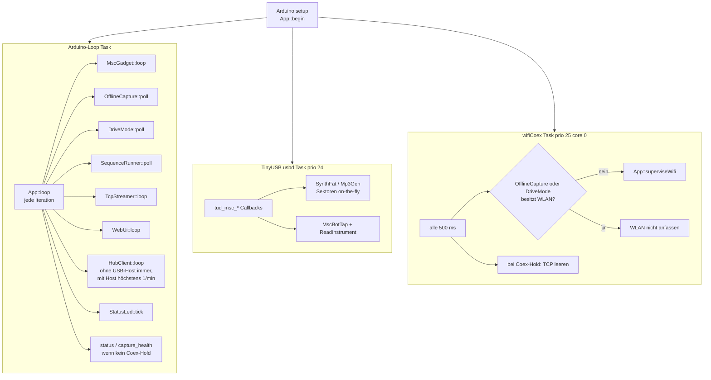
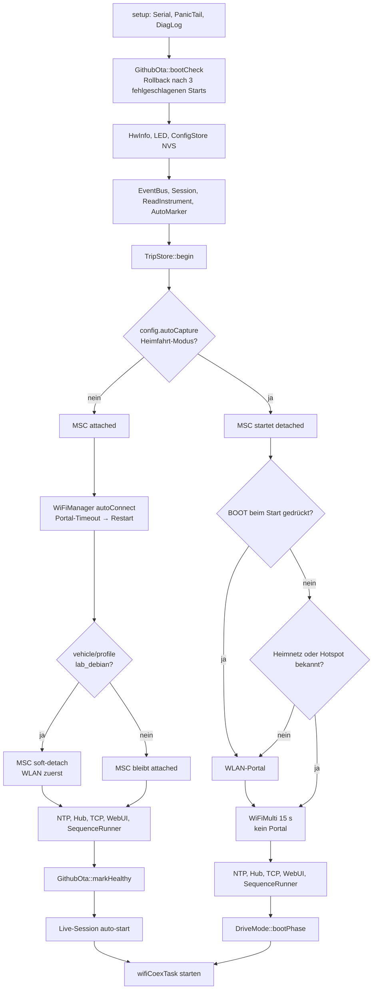
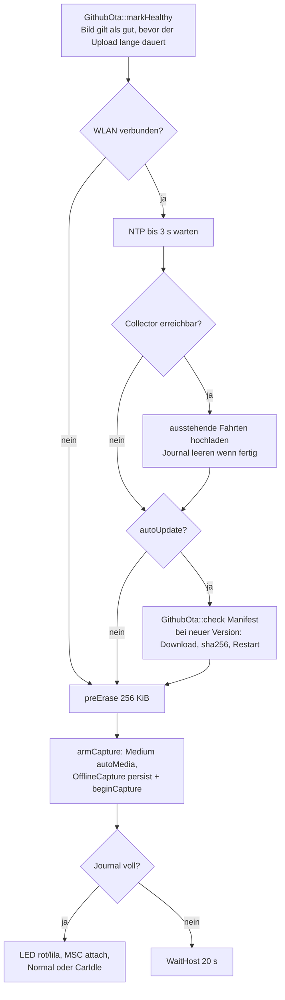
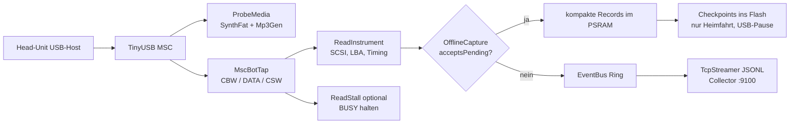
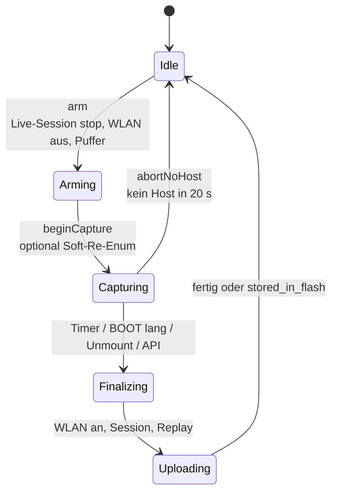
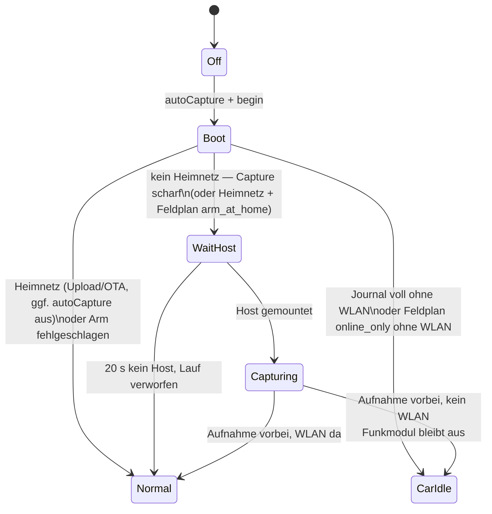
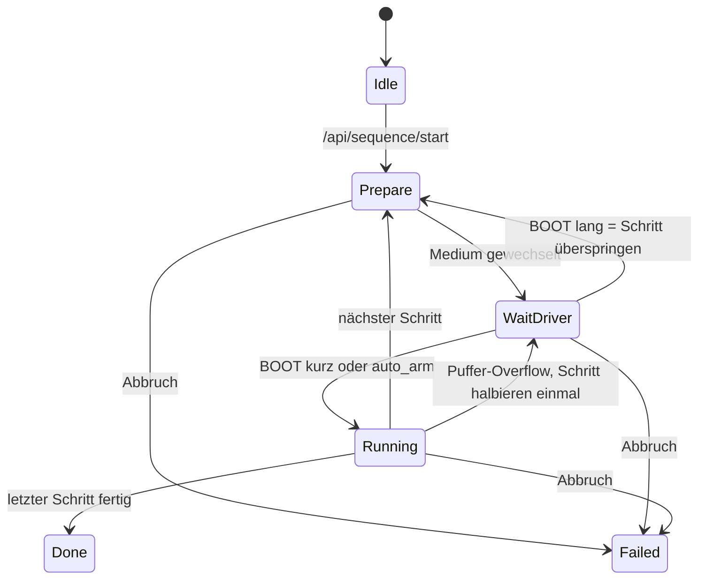
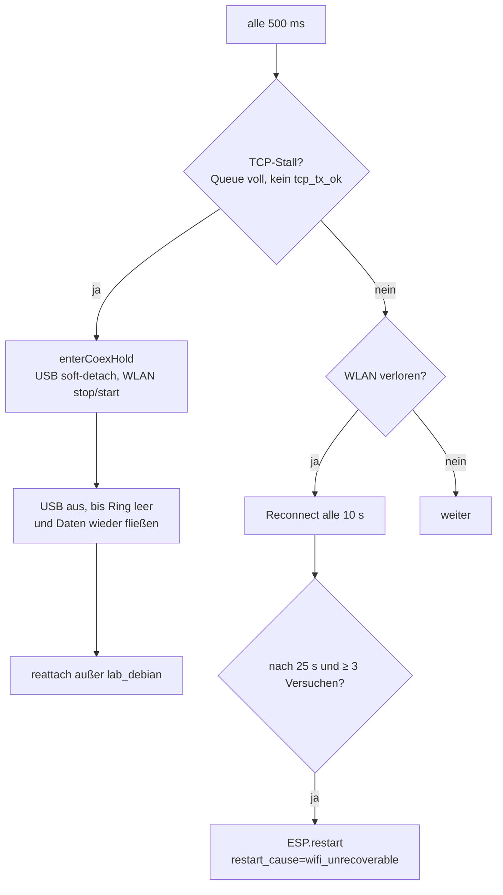
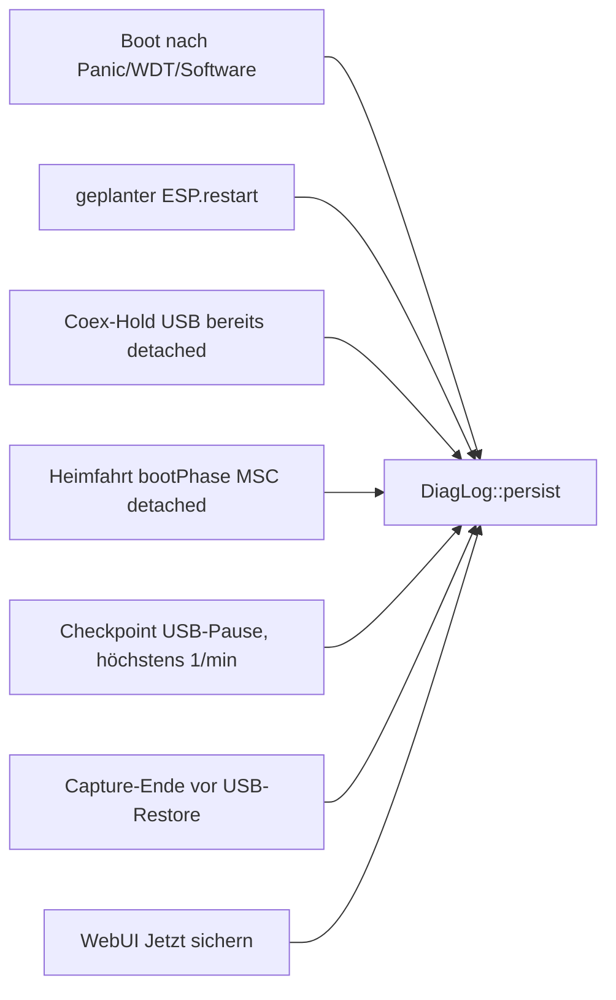

# Firmware-Ablauf (0.3.1)

Stand: aus dem Code abgeleitet (`App::begin`/`loop`, `DriveMode`, `OfflineCapture`, TinyUSB-Pfad).
Nicht auf Hardware nachgezeichnet.

Das README zeigt nur die **Systemübersicht** (HU ↔ Sonde ↔ Collector/Hub). Hier steht der
**interne Ablauf** der Firmware: Start, parallele Tasks, USB-Messpfad und die drei
Zustandsmaschinen.

## Tasks zur Laufzeit



`wifiCoexTask` liegt über TinyUSB (prio 25 vs. 24), weil der Arduino-Loop unter USB-Last
sonst die WLAN-Überwachung nicht mehr erreicht.

## Start (`App::begin`)



`DriveMode::bootPhase` (Heimfahrt, nach der übrigen Initialisierung):



## USB-Messpfad

Zwei Ziele, je nachdem ob gerade offline aufgenommen wird:



Live-Sessions schreiben jedes Ereignis sofort in den EventBus. Offline-Läufe puffern
zuerst (WLAN aus); nach Finalize kommt derselbe TCP-Pfad als Replay.

## Offline-Messung (`OfflineCapture`)

Auslöser: WebUI `/api/experiment/start`, Sequenzschritt oder Heimfahrt `armCapture`.



Während `Capturing`:

- BOOT kurz = nächster Marker (Profil) oder `mark_NN` (freie Marker)
- BOOT doppelt = Soft-Steckzyklus (nur freie Marker)
- BOOT lang ≥ 1,5 s = Stop
- Heimfahrt: in USB-Pausen Checkpoints (`ckpt:<ms>:<KiB>`); Stromverlust sichert bis zum letzten Checkpoint

## Heimfahrt (`DriveMode`)

`autoCapture` in der WebUI. `ownsWifi()` ist in Boot, WaitHost, Capturing und CarIdle wahr —
dann darf `superviseWifi` nicht neu verbinden oder neu starten.



Stromverlust (Zündung aus) ist das normale Ende einer Fahrt: das Image startet neu, lädt
beim nächsten **Heimnetz** die Flash-Fahrt hoch und setzt `autoCapture` zurück, wenn nichts
mehr aussteht. Am Hotspot/ohne WLAN arm't es erneut.

### Feldplan (`FieldPlan`, ab 0.3.41)

Messaufträge für Pendelfahrten stehen in [`field/plan.json`](../field/plan.json) im Repo und
werden bei jedem Start mit WLAN (Heimnetz **oder** Hotspot) von `raw.githubusercontent.com`
gelesen — nur lesend, ohne Token. Die Messdaten gehen weiter über das Flash-Journal und beim
nächsten Start im Heimnetz an den Collector.

```json
{"schema":1,"plan":"2026-11-12a","vehicle":"bmw","enabled":true,"arm_at_home":true,
 "jobs":[{"id":"mix","experiment":"drive_home","media":"drive_mix","fine":false,
          "measure_s":1800,"repeat":4}]}
```

- Eine Fahrt (Start mit Host-Mount) verbraucht einen Lauf; Job k läuft `repeat`-mal, dann
  Job k+1. Szenario der Session: `fp_<plan>_<job>_r<n>`.
- Gezählt wird erst beim Host-Mount; ein Start am Ladegerät (20 s kein Host) verbraucht nichts.
- Plan und Zähler liegen im NVS (`fplan`); ohne Netz gilt der zuletzt geladene Plan. Neue
  `plan`-ID = Zähler auf 0, gleiche ID = Zähler bleibt (z. B. um `enabled` umzuschalten).
- Aktiver Plan (gültig, `enabled`, `vehicle` = `vehicleId`, Läufe übrig): `autoCapture` bleibt an.
  Im Normalbetrieb schaltet ein aktiver Plan `autoCapture` ab dem nächsten Start ein.
  Abschalten: `enabled:false` im Plan oder Feldplan-URL in der WebUI leeren.
- `arm_at_home`: misst auch im Heimnetz (Auto vor dem Haus = Hinfahrt). Ohne das Flag bleibt
  das Heimnetz Upload/Normalbetrieb.
- `online_only`: gemessen wird nur, wenn der Plan bei **diesem** Start geladen wurde. Der
  Handy-Hotspot ist damit der Schalter: Hotspot an + RST bei laufender HU = Messung; Hotspot
  aus = keine Messung (Stick normal sichtbar, Funkmodul aus). Gilt auch, wenn die Läufe des
  Plans aufgebraucht sind (dann misst die Probe mit den WebUI-Standardwerten, aber nur online).
- `stall` je Job (optional): Konfiguration der READ10-Bremse wie `POST /api/stall`
  ([SEQ-STALL](SEQ-STALL.md)), höchstens 127 Zeichen als kompaktes JSON. `DriveMode::armCapture`
  übergibt sie nach dem Medienwechsel an `ReadStall::configure`; die Bremse endet mit der
  Aufnahme (auch bei „kein Host“). Lehnt `ReadStall` die Konfiguration ab, läuft die Aufnahme
  ohne Bremse weiter, `drive.error = stall_config:<grund>`, der Lauf wird **nicht** gezählt.
  `count` ist ohne Angabe 1; für Live-Tempo über ganze Dateien `"count":0`.
- Mehrere Messungen hintereinander: BOOT lang (Aufnahme sauber beenden), dann RST. RST mitten
  in der Aufnahme wirkt wie Stromverlust: gesichert ist nur bis zum letzten Checkpoint (≤ ~90 s
  fehlen).
- Ungültiger oder nicht erreichbarer Plan: der alte bleibt. Prüfen vor dem Push:
  `python tools/validate_field_plan.py` (läuft auch als Workflow `field-plan`).
- Status: WebUI „Heimfahrt-Modus“ bzw. `/api/status` → `drive.field_plan`.

## Sequenz (`SequenceRunner`)



Jeder Schritt ruft `OfflineCapture` auf. Szenario-Name:
`<seq>_<step>r<rep>[p<part>]`.

## WLAN/USB-Coex (`superviseWifi`)

Läuft nur, wenn weder Offline-Capture noch DriveMode das WLAN besitzen.



## Diagnose-Log (was gerade passiert)

USB-Events stehen **nicht** im Diagnose-Log (die gehören in die Messung). `DiagLog` sammelt
nur den Lebenszyklus: WLAN, Capture-Zustände, DriveMode, OTA, Coex, Restarts.

| Speicher | Überlebt | Größe | Lesen |
|---|---|---|---|
| PSRAM-Ring | bis Reset | 64 KiB | WebUI Diagnose, `GET /api/diag/log` |
| RTC | Software-Reset, Panic, Watchdog — **nicht** Zündung aus | 2 KiB + 32 Breadcrumbs | Kopf von `/api/diag/log`, `panic_tail` / `panic_now` in `/api/status` |
| Flash-Snapshots | Stromverlust | 8 × 4 KiB (Anfang der `spiffs`-Partition, kein Dateisystem) | WebUI Flash-Snapshots, `GET /api/diag/saved` |

Flash wird nur an sicheren Stellen beschrieben (kein USB-Bulk):



Ein Freeze ohne Watchdog hinterlässt nichts — das kann kein Log nachholen. Danach: Reset-Grund
`task_watchdog` / `panic` in der WebUI, letzter Flash-Snapshot, vorheriger RTC-Tail.

## Wo steuern?

| Absicht | Einstieg |
|---|---|
| Live messen (Labor) | WebUI Live-Session; Lab `lab_debian` muss MSC erst anhängen |
| Ein Experiment | WebUI Messlauf oder `POST /api/experiment/start` |
| Sequenz | WebUI Sequenz oder `POST /api/sequence/start` |
| Tägliche Fahrt | WebUI Heimfahrt-Modus `autoCapture` |
| Firmware holen | Hub-OTA, WebUI-Upload oder GitHub-Manifest (`enabled: true`) |
| Nachschauen was die Sonde tat | WebUI Karte Diagnose, `/api/diag/log`, `/api/diag/saved` |

Siehe [Offline-Capture](OFFLINE-CAPTURE.md), [Heimfahrt-Modus](feld/archiv/2026-10-22-msc-kampagne/heimfahrt-modus.md),
[Szenarien](SZENARIEN.md).
