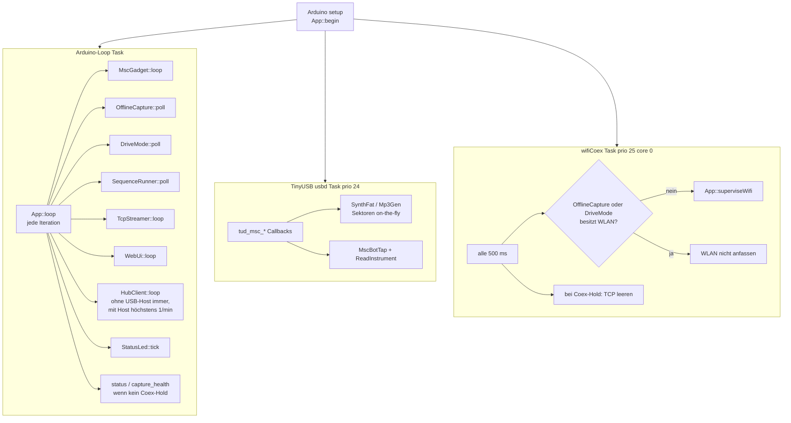
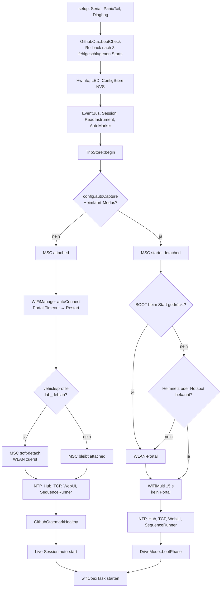
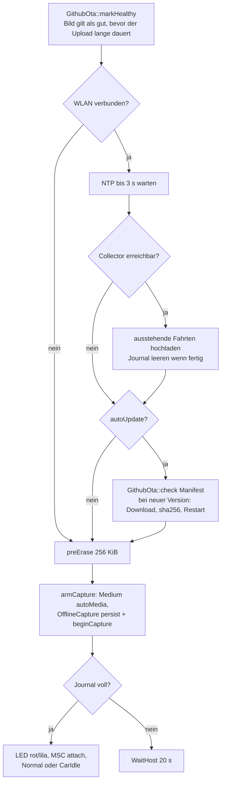
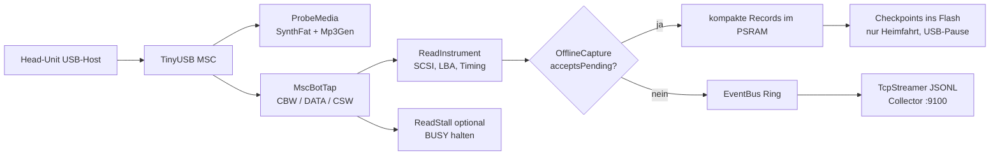
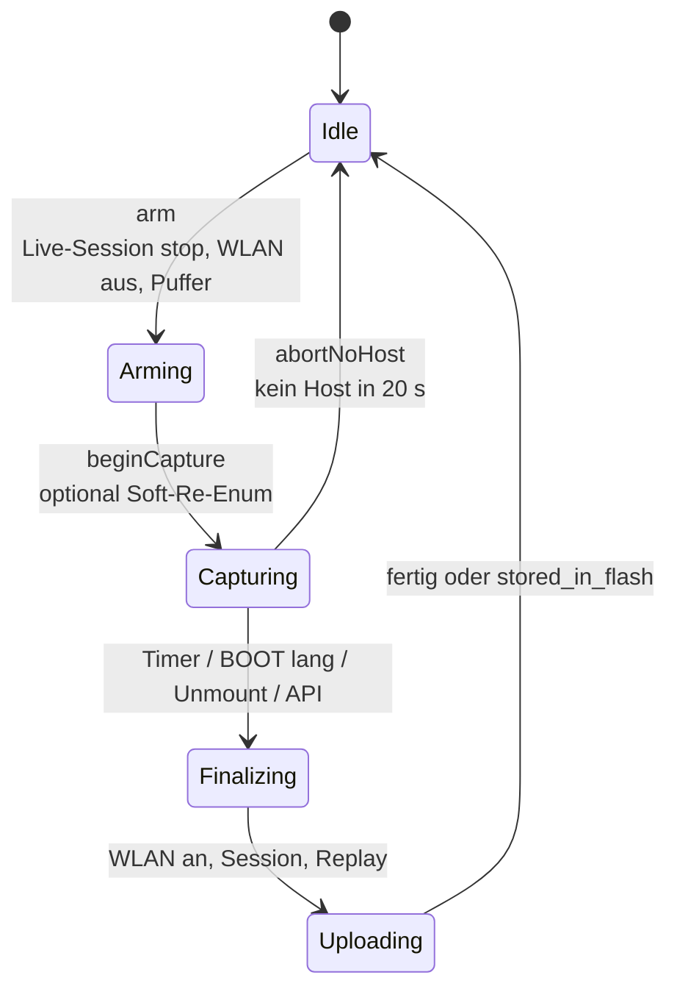
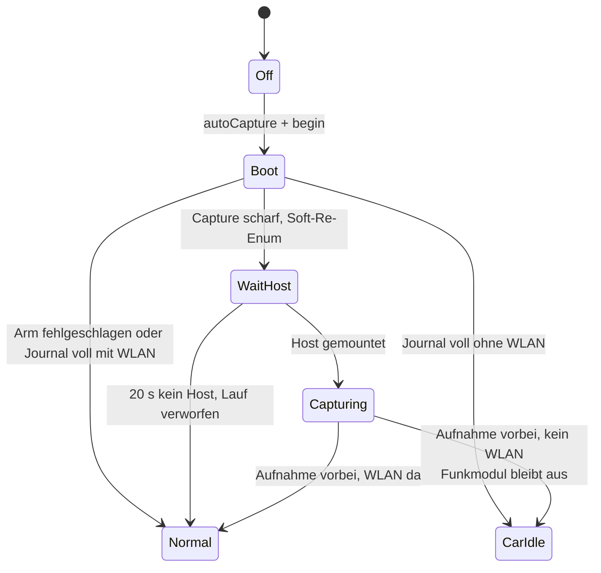
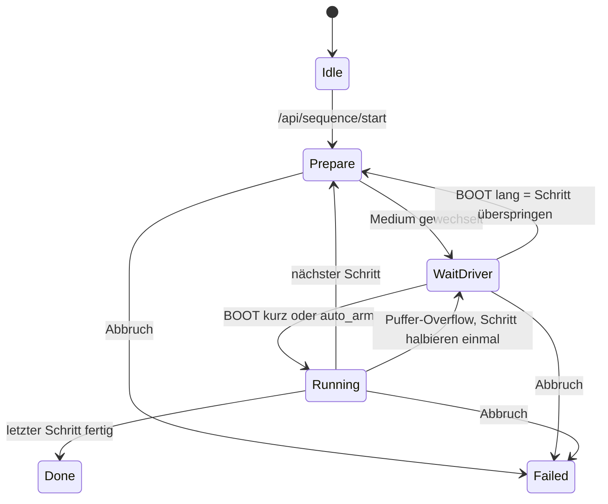
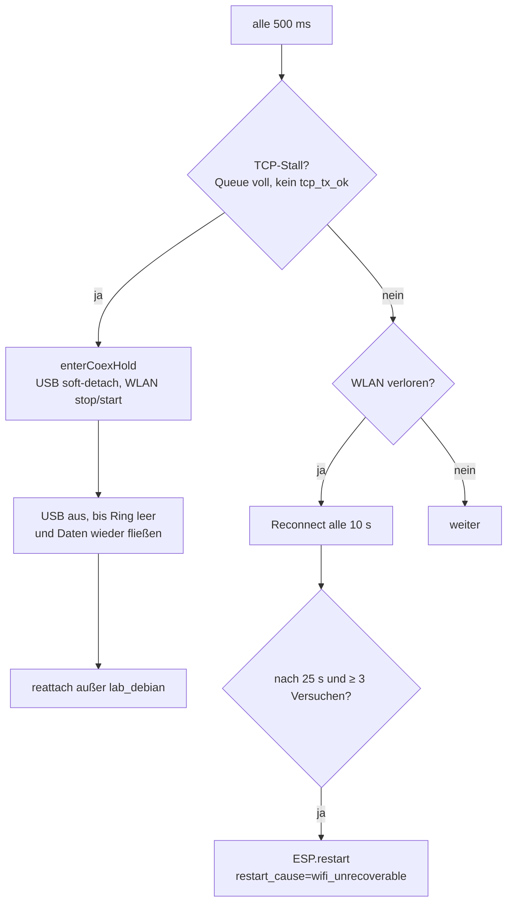
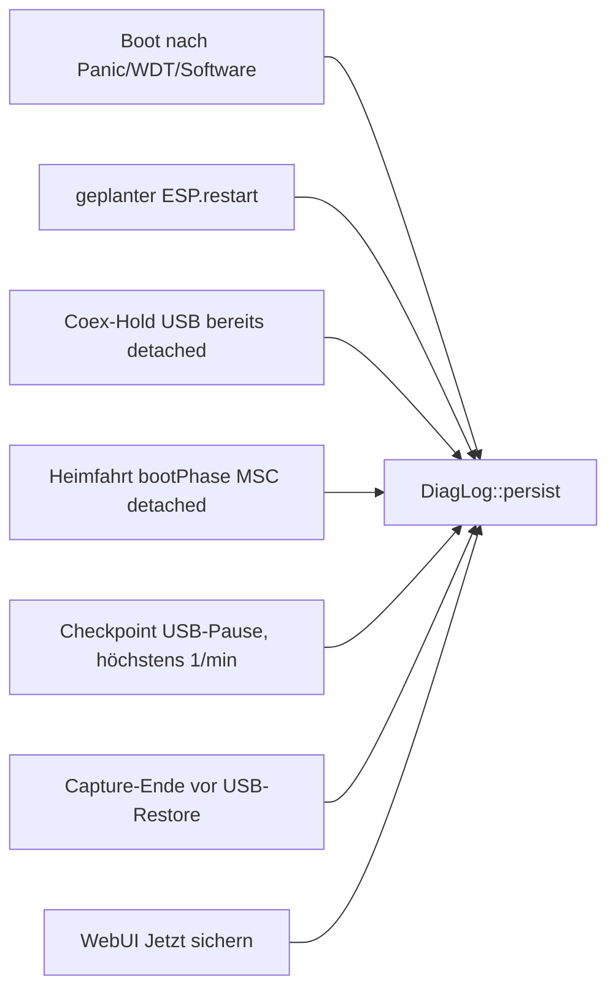

# Firmware-Ablauf (0.3.1)

Stand: aus dem Code abgeleitet (`App::begin`/`loop`, `DriveMode`, `OfflineCapture`, TinyUSB-Pfad).
Nicht auf Hardware nachgezeichnet.

Das README zeigt nur die **Systemübersicht** (HU ↔ Sonde ↔ Collector/Hub). Hier steht der
**interne Ablauf** der Firmware: Start, parallele Tasks, USB-Messpfad und die drei
Zustandsmaschinen.

## Tasks zur Laufzeit

`wifiCoexTask` liegt über TinyUSB (prio 25 vs. 24), weil der Arduino-Loop unter USB-Last
sonst die WLAN-Überwachung nicht mehr erreicht.

## Start (`App::begin`)

`DriveMode::bootPhase` (Heimfahrt, nach der übrigen Initialisierung):

## USB-Messpfad

Zwei Ziele, je nachdem ob gerade offline aufgenommen wird:

Live-Sessions schreiben jedes Ereignis sofort in den EventBus. Offline-Läufe puffern
zuerst (WLAN aus); nach Finalize kommt derselbe TCP-Pfad als Replay.

## Offline-Messung (`OfflineCapture`)

Auslöser: WebUI `/api/experiment/start`, Sequenzschritt oder Heimfahrt `armCapture`.

Während `Capturing`:

- BOOT kurz = nächster Marker (Profil) oder `mark_NN` (freie Marker)
- BOOT doppelt = Soft-Steckzyklus (nur freie Marker)
- BOOT lang ≥ 1,5 s = Stop
- Heimfahrt: in USB-Pausen Checkpoints (`ckpt:<ms>:<KiB>`); Stromverlust sichert bis zum letzten Checkpoint

## Heimfahrt (`DriveMode`)

`autoCapture` in der WebUI. `ownsWifi()` ist in Boot, WaitHost, Capturing und CarIdle wahr —
dann darf `superviseWifi` nicht neu verbinden oder neu starten.

Stromverlust (Zündung aus) ist das normale Ende einer Fahrt: das Image startet neu, lädt
beim nächsten Heimnetz die Flash-Fahrt hoch und arm't erneut.

## Sequenz (`SequenceRunner`)

Jeder Schritt ruft `OfflineCapture` auf. Szenario-Name:
`<seq>_<step>r<rep>[p<part>]`.

## WLAN/USB-Coex (`superviseWifi`)

Läuft nur, wenn weder Offline-Capture noch DriveMode das WLAN besitzen.

## Diagnose-Log (was gerade passiert)

USB-Events stehen **nicht** im Diagnose-Log (die gehören in die Messung). `DiagLog` sammelt
nur den Lebenszyklus: WLAN, Capture-Zustände, DriveMode, OTA, Coex, Restarts.

| Speicher | Überlebt | Größe | Lesen |
|---|---|---|---|
| PSRAM-Ring | bis Reset | 64 KiB | WebUI Diagnose, `GET /api/diag/log` |
| RTC | Software-Reset, Panic, Watchdog — **nicht** Zündung aus | 2 KiB + 32 Breadcrumbs | Kopf von `/api/diag/log`, `panic_tail` / `panic_now` in `/api/status` |
| Flash-Snapshots | Stromverlust | 8 × 4 KiB (Anfang der `spiffs`-Partition, kein Dateisystem) | WebUI Flash-Snapshots, `GET /api/diag/saved` |

Flash wird nur an sicheren Stellen beschrieben (kein USB-Bulk):

Ein Freeze ohne Watchdog hinterlässt nichts — das kann kein Log nachholen. Danach: Reset-Grund
`task_watchdog` / `panic` in der WebUI, letzter Flash-Snapshot, vorheriger RTC-Tail.

## Wo steuern?

| Absicht | Einstieg |
|---|---|
| Live messen (Labor) | WebUI Live-Session; Lab `lab_debian` muss MSC erst anhängen |
| Ein Experiment | WebUI Messlauf oder `POST /api/experiment/start` |
| Sequenz | WebUI Sequenz oder `POST /api/sequence/start` |
| Tägliche Fahrt | WebUI Heimfahrt-Modus `autoCapture` |
| Firmware holen | Hub-OTA, WebUI-Upload oder GitHub-Manifest (`enabled: true`) |
| Nachschauen was die Sonde tat | WebUI Karte Diagnose, `/api/diag/log`, `/api/diag/saved` |

Siehe [Offline-Capture](OFFLINE-CAPTURE.md), [Heimfahrt-Modus](feld/heimfahrt-modus.md),
[Szenarien](SZENARIEN.md).
